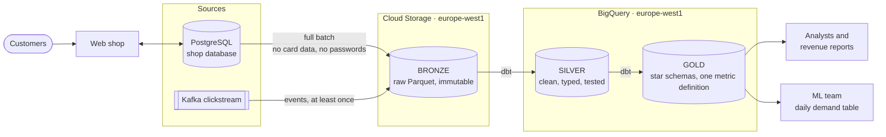
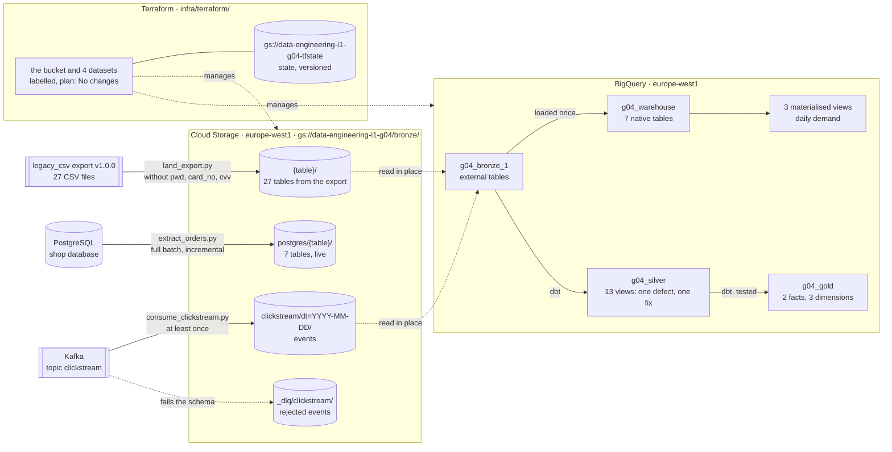

# Architecture

> Update this page at the end of every lesson. It is the diagram you present at
> the oral defence.

## Context

Albert's Marketplace's analysts, revenue reports and ML team all read from the
PostgreSQL database that runs the web shop. That slows checkout, exposes
passwords and card data, and produces revenue figures that disagree
([data flows](data-flows.md)). The platform has to give analysts and reports one
trusted revenue figure in SQL, and give the ML team units sold per product, per
country, per day. A daily refresh is enough for both. The constraints: card
data and passwords must never leave the shop, the shop database is read only by
the ingestion job, and the team is SQL-first and new to running cloud
infrastructure.

## Target architecture

Chosen in [ADR-0001](adr/0001-target-architecture.md): a **two-tier** platform.
Raw files live in Cloud Storage, and the warehouse in BigQuery is built from
them with dbt. The extractor and the consumer are our own
([ADR-0003](adr/0003-ingestion-modes.md)). Not yet decided: the scheduler (L07).

**Two boundaries in the diagram matter:**

- **The shop database:** only the extraction arrow crosses it. Nothing else
  reads the shop database.
- **Gold:** consumers read nothing else. They never see bronze or silver.

## What exists now (L09)

| What | Details | Who can read it |
|---|---|---|
| **Bucket** `gs://data-engineering-i1-g04` | `europe-west1`, Standard, uniform access. Files under `bronze/` move to Nearline at 30 days, Coldline at 90, Archive at 365; nothing is deleted ([lifecycle](../infra/README.md)) | The project's owners, editors and viewers, through the bucket's default bindings |
| **The export** | `bronze/<table>/`: one file per table, `orders` by year of `order_date` ([ADR-0002](adr/0002-bronze-layout.md)) | |
| **The extractor** | `bronze/postgres/<table>/`: seven tables, replaced at each run. `bronze/postgres/_incremental/orders/` and a saved cursor ([ADR-0003](adr/0003-ingestion-modes.md)) | |
| **The clickstream** | `bronze/clickstream/dt=YYYY-MM-DD/`, by `event_time`, at least once. Rejected events in `bronze/_dlq/clickstream/` | |
| **Dataset** `g04_bronze_1` | External tables over the export and the clickstream: nothing is copied into BigQuery | Till and Enzo (owners), Evaluna and Jane (BigQuery Data Viewer), the project's owners ([access](../infra/iam.md)) |
| **Dataset** `g04_warehouse` | Seven native tables, partitioned and clustered, and three materialised views. `shipping_details` keeps only `address_id` and `country` ([tuning](warehouse-tuning.md)). On demand, with a 100 MiB cap ([ADR-0004](adr/0004-warehouse-pricing.md)) | Enzo (owner), Jane (BigQuery Data Viewer), the project's owners ([access](../infra/iam.md)) |
| **Datasets** `g04_silver`, `g04_gold` | Built by dbt from `g04_bronze_1` ([transform/](../transform/README.md)): views for silver, tables for gold ([ADR-0005](adr/0005-materialisations.md)). Twins removed, every grain tested ([acceptance criteria](acceptance-criteria.md), [lineage](lineage.md)) | Till and Enzo (owners), Jane and Evaluna (BigQuery Data Editor), the project's owners ([access](../infra/iam.md)) |
| **Images** | `jgalthie/group4-ingestion` (extractor and consumer) and `jgalthie/group4-transform` (dbt) on Docker Hub, tagged by date and commit, never `latest`, for amd64 and arm64 | |
| **Terraform** | `infra/terraform/` declares the data bucket and the four datasets, adopted with import blocks until the plan said "No changes". Provider pinned, `fmt` and `validate` on every PR that touches `infra/` ([infra](infra.md)) | Enzo runs the plan and the apply |
| **Terraform state** | `gs://data-engineering-i1-g04-tfstate`, versioned, made by hand because it cannot hold its own state ([ADR-0008](adr/0008-remote-state.md)) | The project's viewers, through the bucket's default bindings ([infra](infra.md)) |
| **Labels** | `group`, `environment`, `layer`, `lesson` on everything Terraform manages ([ADR-0009](adr/0009-cost-attribution.md), [costs](costs.md)) | |

**Not yet as in the target:**

- **No service account** (Charles): jobs run as our own Google logins.
- **Access is not in Terraform:** the dataset bindings were applied by hand
  ([infra](infra.md), gaps).
- **Nothing runs on a schedule:** a person starts each path (L07).
- **Silver and the warehouse read the export.** Nothing reads the extractor's
  files yet.
- **Silver still holds buyer IDs,** not pseudonymised (L10). Gold holds none.
- **The files do not record their load time,** and rerunning the landing or a
  full batch replaces them instead of adding new ones.

## Layers

| Layer | What lands here | What it guarantees | Who reads it |
|---|---|---|---|
| **Bronze** (Cloud Storage) | One folder per source table, as partitioned Parquet (layout decided in L02, ADR-0002). Columns are as extracted, minus `customer.pwd` and `payment_details.card_no` and `cvv`, which are never extracted. Clickstream events from L03 | **Exactly what the source sent at each load, never modified.** Files are only added, each one records its source and load time, so silver and gold can be rebuilt at any time | The group, through `g04_bronze_1` ([access](../infra/iam.md)). Jobs run as our own logins: there is no service account |
| **Silver** (BigQuery) | One table per business entity (orders, order lines, products, customers, addresses, payments). Types and UTC timestamps are fixed, duplicates and the export's index column removed. Names, emails and phone numbers are pseudonymised | **Correct and consistent.** Every row has a unique, non-null key, foreign keys resolve, and types are enforced. dbt tests fail the build if not | The data team, to build and debug gold |
| **Gold** (BigQuery) | Star schemas and metrics for consumers. First: daily demand (units per product, country and day, [sketch](model/star-daily-demand.md)) and revenue | **One definition per figure, with a documented grain.** Revenue is computed in one model, from `price_at_purchase`. No direct identifiers. Partitioned by date | Analysts, revenue reports, ML team |

## Decisions

| ADR | Decision | Status |
|---|---|---|
| [0001](adr/0001-target-architecture.md) | Two-tier: raw Parquet in Cloud Storage, silver and gold in BigQuery, built with dbt | Accepted |
| [0002](adr/0002-bronze-layout.md) | Bronze as snappy Parquet, one folder per table, `orders` by year; the three secret columns are never read | Accepted |
| [0003](adr/0003-ingestion-modes.md) | Database tables in full batch, with an incremental cursor as a second mode; the clickstream as a stream, at least once | Accepted |
| [0004](adr/0004-warehouse-pricing.md) | BigQuery on demand, with a 100 MiB cap on every query | Accepted |
| [0005](adr/0005-materialisations.md) | Silver as views, gold as tables rebuilt in full | Accepted |
| [0008](adr/0008-remote-state.md) | Terraform state in a versioned bucket made by hand | Accepted |
| [0009](adr/0009-cost-attribution.md) | Cost attributed with four resource labels | Accepted |

## Change log

| Lesson | What changed |
|---|---|
| L01 | First version: target architecture, layer guarantees, ADR-0001 |
| L02 | Bronze exists: the group bucket, its layout and lifecycle, `g04_bronze_1` and who can read it, ADR-0002 |
| L03 | Three paths into bronze: the export, the extractor and the clickstream, with a dead letter queue. ADR-0003 |
| L04 | The warehouse: seven native tables, the daily demand views, the query cap. ADR-0004 |
| L05 | Silver and gold with dbt: the twin rule, the star, tests on every grain. ADR-0005 |
| L06 | The jobs as pinned, non-root images on Docker Hub |
| L08 | The bucket and the datasets declared in Terraform, with remote state and CI. ADR-0008 |
| L09 | Labels on every managed resource. ADR-0009 |
