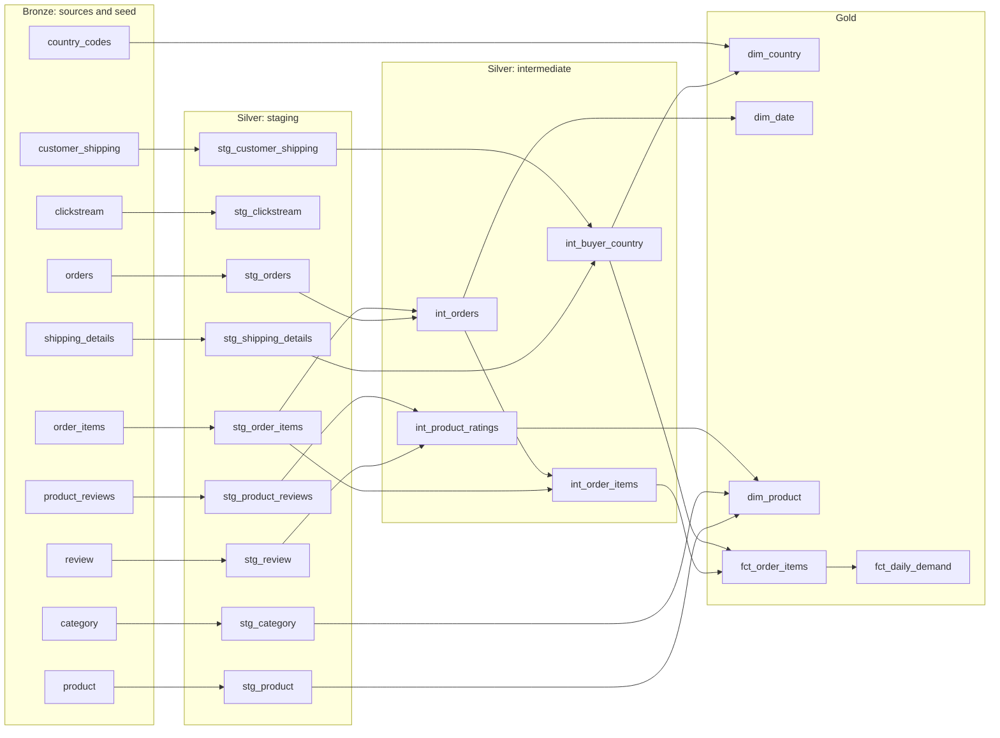

# Lineage

Which model is built from which, read from dbt's `manifest.json` on 6 November
2026. To explore it, tests included: `dbt docs generate`, then
`dbt docs serve --port 8080 --host 0.0.0.0`
([how to run dbt](../transform/README.md)).

`category`, `customer_shipping` and the others on the left are bronze tables.
`clickstream` feeds `stg_clickstream` and nothing else yet: no gold model reads
it.

## If `orders`, the most upstream source, changes shape

`orders` reaches every fact: `stg_orders` → `int_orders` → `int_order_items` →
`fct_order_items` → `fct_daily_demand`, and `dim_date`, which is built from the
first and last order.

1. **A new column:** nothing breaks and nothing sees it. Staging names its
   columns, so add it to `stg_orders` if a model needs it.
2. **A dropped or renamed column:** `stg_orders` fails at the next build, and
   `dbt build` skips everything downstream. Gold keeps yesterday's data. Check
   the column list in `stg_orders` first, then the three columns the twin rule
   compares: `buyer_id`, `payment_id` and `order_date`.
3. **A changed type:** the most dangerous. If `order_date` became a timestamp,
   `DATE_DIFF` could still run and the rule still look fine. Run the unit test
   on `int_orders`, then `assert_no_twin_orders`.
4. **A new way of writing orders:** if an order could be corrected rather than
   duplicated, the twin rule's 4-day window needs a new look. No test catches
   that: compare gold's revenue with `payment` by hand.
